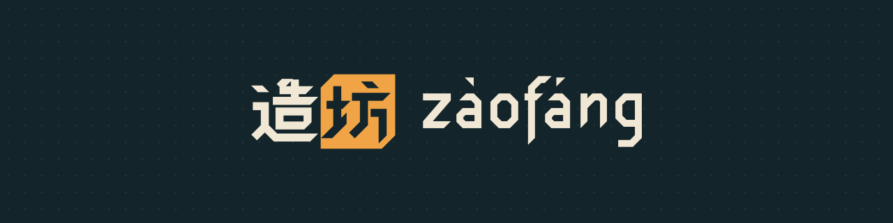

<picture>
  <source media="(prefers-color-scheme: light)" srcset="social/readme-banner-light.svg">
  
</picture>

# zaofang/brand

Source files for Zaofang's identity: logos, colour tokens, terminal and editor themes, and the type-on animation. The brand guide explains when and how to use them. Every file here is generated by `src/`; change the code, not the outputs.

## What's here

| Path | Contents |
| --- | --- |
| `logo/` | Lockup and lockup with tones, 造坊 mark, wordmark and wordmark with tones, each `on-dark`, `on-light` and `mono` (currentColor) SVG; avatar, favicon SVG and ICO |
| `logo/png/` | PNG exports: avatar 256/512/1024, favicon 16 to 512, lockups at 1200 px |
| `social/` | README banners (dark, light), Open Graph card 1200×630, GitHub social preview 1280×640 |
| `motion/` | `typeon.svg` (type-on with blinking cursor), `splash.sh` (CLI splash) |
| `tokens/` | `tokens.css` (custom properties, dark first) and `tokens.json` (Design Tokens format) |
| `themes/` | Ghostty, Alacritty, Kitty, WezTerm, Windows Terminal, VS Code (also loads in Shiki) and Neovim |
| `book/` | `zaofang-brand-book.pdf`, the brand book: name, voice, logo, colour, type, motion, motifs, sub-projects, applications |
| `fonts/` | Which typefaces, where to get them, their licence |
| `src/` | The drawing code: Bevel 造坊, the zaofang letters, spacing, cursor, palette, writers |

## Use

- **Web:** `@import "tokens/tokens.css";` then `var(--zf-bg)`, `var(--zf-text)`, `var(--zf-accent)` and so on. Set `data-theme="light"` or `"dark"` on `<html>` to override the system setting.
- **Favicon:** `<link rel="icon" href="/favicon.svg" type="image/svg+xml">` with `favicon.ico` as fallback and `favicon-180.png` as `apple-touch-icon`.
- **Ghostty:** copy `themes/ghostty/zaofang-lamplight-dark` to `~/.config/ghostty/themes/`, then `theme = zaofang-lamplight-dark`.
- **Alacritty:** `import = ["~/.config/alacritty/zaofang-lamplight-dark.toml"]` under `[general]`.
- **Kitty:** `include zaofang-lamplight-dark.conf`.
- **WezTerm:** put the file in a `color_schemes_dirs` folder, then `color_scheme = "Zaofang Lamplight Dark"`.
- **Windows Terminal:** paste the schemes from `themes/windows-terminal/schemes.json` into `settings.json`.
- **VS Code:** copy `themes/vscode` to `~/.vscode/extensions/zaofang-lamplight`, restart, pick Zaofang Lamplight. Shiki: `import theme from "./themes/vscode/themes/zaofang-lamplight-dark-color-theme.json"`.
- **Neovim:** copy `themes/nvim/colors/zaofang.lua` into `~/.config/nvim/colors/`, then `:colorscheme zaofang`. It follows `background`.

## Regenerate

```sh
uv run zaofang-brand                              # SVGs, tokens, themes
uv run --extra png playwright install chromium    # once
uv run --extra png scripts/export_png.py          # PNGs, ICO, social cards
uv run --extra png scripts/book.py                # brand book PDF (after the two above)
```

## Licence

Code, tokens and themes (`src/`, `scripts/`, `tokens/`, `themes/`) are MIT; see `LICENSE`. The logos and the names zaofang and 造坊 are trademarks: the files are public so you can refer to Zaofang correctly, under the rules in `TRADEMARK.md`. Fonts are under the SIL Open Font License; see `fonts/README.md`.
